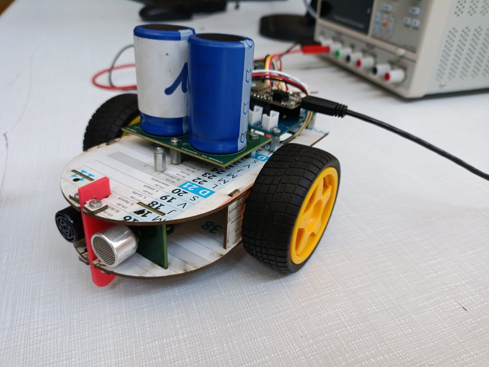
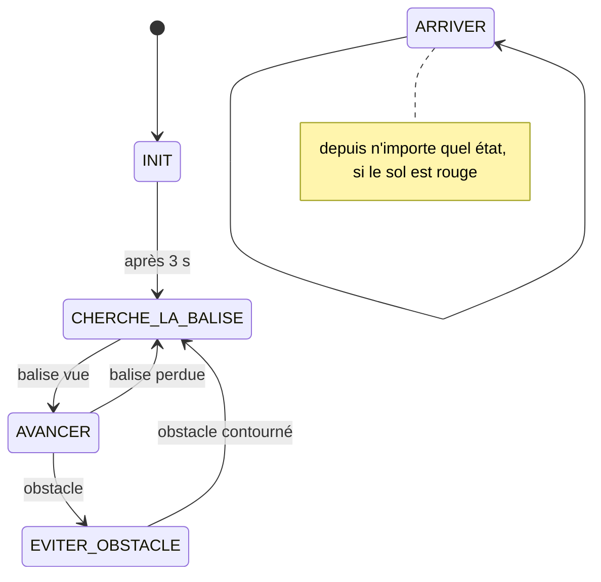

# Robot Léo – gestion et alimentation

Firmware et carte d'alimentation d'un petit robot autonome réalisé pour la coupe de robotique du département GEII de l'IUT de Nantes (SAÉ2, 2026).

Le robot part d'un coin d'une arène de 8 × 8 m. Il doit rejoindre une balise infrarouge placée dans le coin opposé en évitant les obstacles et les autres robots, puis s'arrêter sur la zone d'arrivée, marquée par une feuille rouge. Il n'a pas de batterie : il est chargé avant chaque course par un vélo générateur.



*Au premier plan, la carte d'alimentation (FP3) avec ses deux supercondensateurs de 200 F ; derrière, la carte principale ESP32 (FP2). À l'avant, le sonar à ultrasons.*

Le robot a été réalisé en équipe de 3 et découpé en cartes (sonar, balise IR, puissance moteurs…). Ce dépôt contient les deux parties dont j'étais responsable :

- **FP2, gestion du robot :** la carte principale ESP32 et la stratégie de course ([firmware/](firmware/)).
- **FP3, alimentation :** une carte à supercondensateurs (schéma et PCB décrits plus bas ; fichiers KiCad non publiés).

## FP2 – Gestion du robot

### Carte et câblage

Module **Adafruit HUZZAH32** (ESP32-WROOM). Les autres cartes lui envoient des signaux logiques simples. Seul le capteur couleur passe par l'I2C.

| Signal | Broche ESP32 | Rôle |
|---|---|---|
| `OBSTACLE` | 36 | 1 = obstacle détecté par le sonar (carte FP1) |
| `BALISE` | 5 | 1 = balise vue en face (carte FP4) |
| `motorFD` / `motorFG` | 32 / 33 | Sens moteur droit / gauche (FIN) |
| `motorRD` / `motorRG` | 14 / 15 | PWM moteur droit / gauche (RIN) |
| SDA / SCL | I2C | Capteur couleur VEML6040 (adresse `0x10`) |

PWM : périphérique LEDC de l'ESP32, 1 kHz, 8 bits.
Avec le driver utilisé, quand FIN est à l'état haut, un rapport cyclique de 0 sur RIN donne la vitesse maximale. Les fonctions `forward()`, `left()` et `right()` inversent donc la consigne (`255 - vitesse`) pour qu'une vitesse de 255 corresponde bien au maximum.

### Stratégie



- **Recherche :** rotation sur place jusqu'à voir la balise. Le sens de rotation dépend de la dernière esquive : après un contournement par la droite, la balise est probablement à gauche.
- **Évitement :** le robot pivote à droite tant que le sonar voit l'obstacle, ajoute un sur-virage de 250 ms, puis avance 800 ms pour dégager le châssis.
- **Arrivée :** le VEML6040 lit le sol en continu. Le robot s'arrête si `R > 1,5 × (G + B)` et `R > 1500`. Le ratio rend la détection moins sensible à l'éclairage, et le seuil absolu évite les faux positifs sur les zones sombres.

### Compiler

Arduino IDE, carte « Adafruit ESP32 Feather ». Le code utilise l'ancienne API LEDC (`ledcSetup` / `ledcAttachPin`) : il faut le **core ESP32 2.x**. Avec le core 3.x, il faudrait passer à `ledcAttach()`.

### Limites connues

Voici ce que je changerais avec le recul :

- `EVITER_OBSTACLE` est **bloquant** (`while` + `delay`). Pendant l'esquive, le robot ne lit plus la balise ni le capteur couleur.
- Le robot esquive **toujours par la droite**, donc `derniere_esquive_droite` vaut toujours `true` et la recherche tourne toujours à gauche. Il faudrait choisir le côté d'esquive (par exemple en alternant) pour que la mémoire serve vraiment.
- `OBSTACLE` est câblé sur le GPIO 36, une entrée sans résistance de tirage interne (GPIO 34 à 39) : `INPUT_PULLUP` n'y a aucun effet, l'état au repos dépend de la sortie de la carte sonar. Il faudrait écrire `INPUT`, ou ajouter une résistance de tirage sur la carte.
- Le Bluetooth (`SerialBT`) est initialisé mais pas utilisé. Il pourrait servir à suivre l'état du robot à distance pendant les essais.

## FP3 – Alimentation par supercondensateurs

### Dimensionnement

La batterie LiPo est remplacée par deux supercondensateurs **Vishay SCCX50B207SSB (200 F, 2,7 V) en série**. Une seule cellule ne monte pas assez haut en tension, et la mise en série évite d'ajouter un hacheur élévateur.

Durée de décharge à 500 mA, entre 4,2 V et 3,3 V aux bornes de l'ensemble (5,4 V au maximum avec 2 × 2,7 V) :

```
Δt = C·ΔV / I
2 cellules en série : C_éq = 200 F / 2 = 100 F
Δt = 100 F × 0,9 V / 0,5 A = 180 s
```

### Schéma

- **Équilibrage actif :** un AOP maintient le point milieu, pour qu'une cellule ne dépasse pas sa tension maximale à cause des courants de fuite (montage recommandé par Würth Elektronik). Avec des charges et décharges rapides, des résistances d'équilibrage passives seraient trop lentes.
- **Protection :** fusible électronique 5 A et découplage 2 × 100 nF.

### PCB (KiCad, double face)

- **Puissance** sur F.Cu, **commande** (équilibrage) sur B.Cu.
- Zones de cuivre larges à la place des pistes pour VCC, GND et le point milieu, avec des plans sur les deux faces.
- CMS en face inférieure. Les supercondensateurs et le bornier sont en traversant.

### Tests

- Carte brasée et testée par mes soins (CMS en face inférieure, composants traversants en face supérieure).
- Charge complète des deux cellules : pas d'échauffement de l'AOP ni des zones de puissance.
- Branchée sur la carte principale, la carte fournit le courant d'appel de l'ESP32 et des drivers moteurs au démarrage. Le robot s'initialise normalement.
- Pas de prototype sur plaque d'essai pour cette fonction : le montage d'équilibrage est un schéma documenté, validé sur le papier avant de passer au PCB.

## Contenu

```
firmware/FP2_gestion_robot/   code de la carte principale
docs/                         photo du robot
```

---

Projet pédagogique (SAÉ2, BUT GEII, IUT de Nantes), partagé à titre de portfolio.
